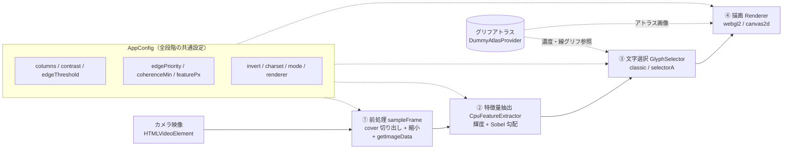
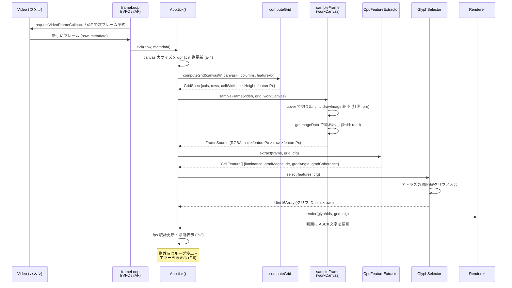
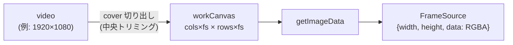
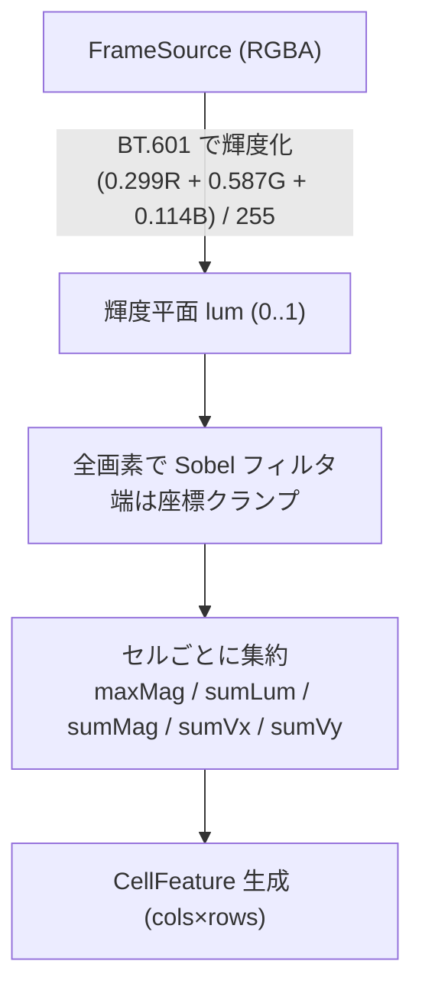
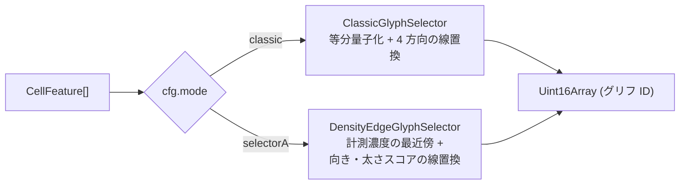
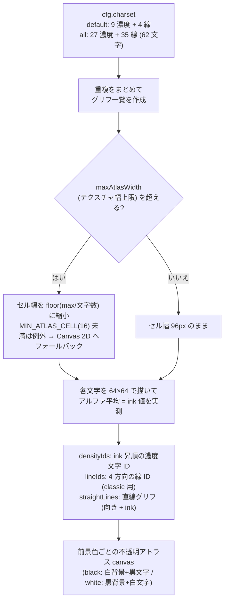
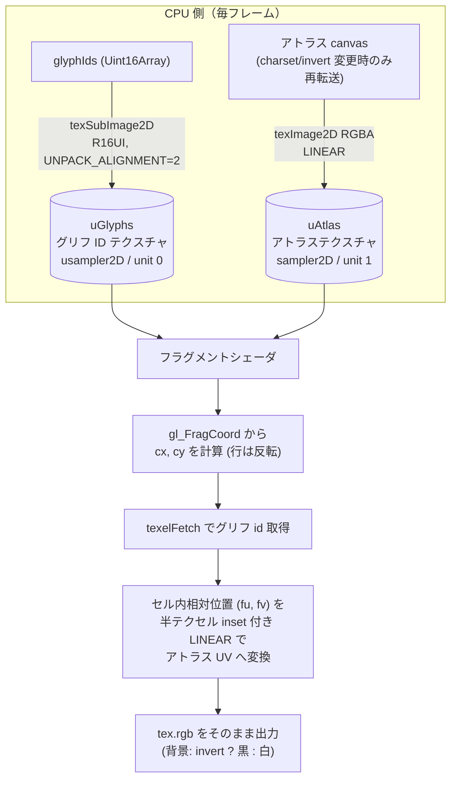
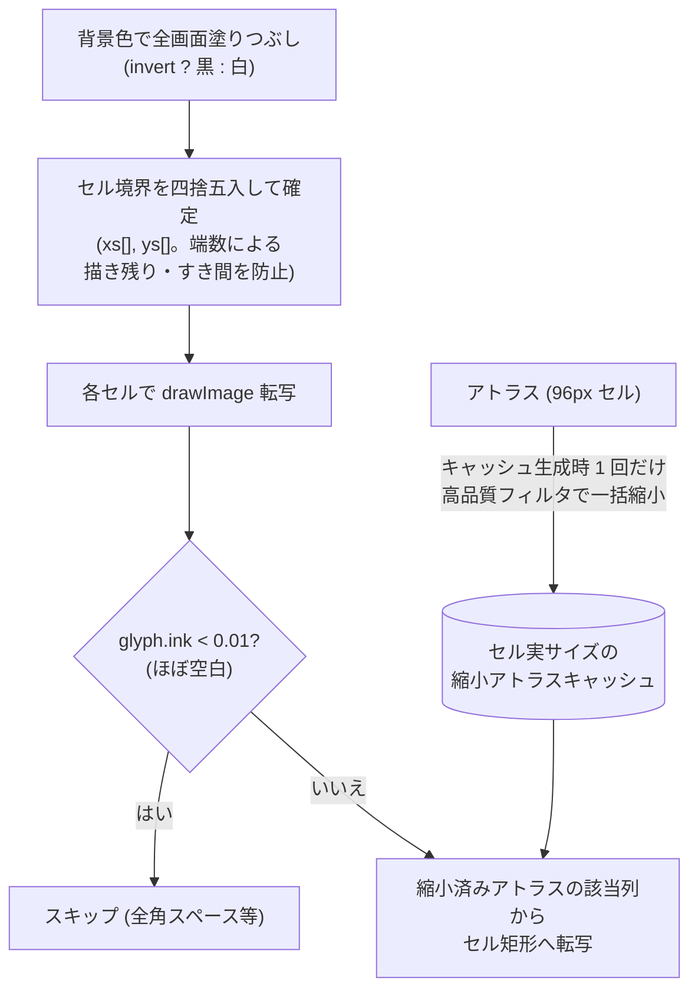
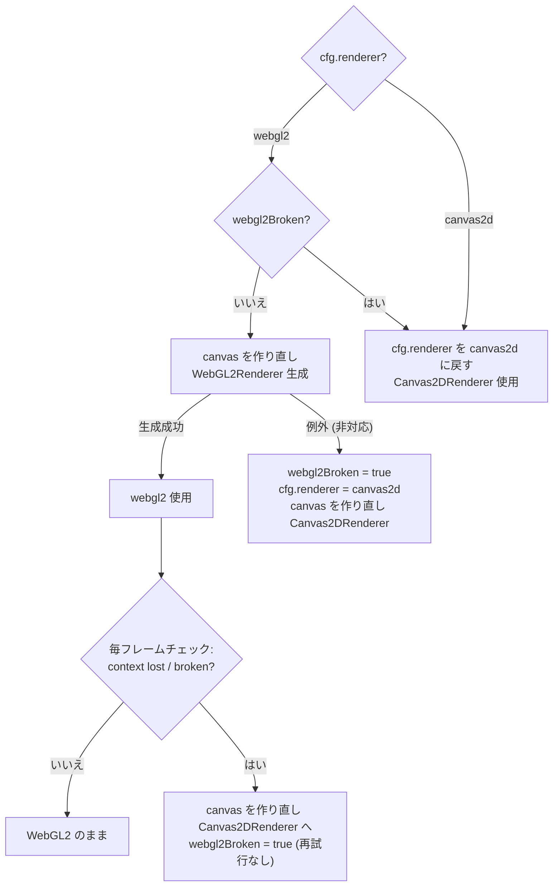
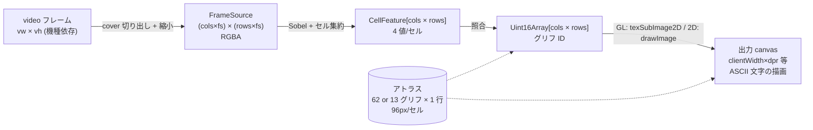

# Web 版 ASCII 化パイプライン解説（2026-11-15 時点）

`src/` の現行コードを読み、カメラ映像が ASCII 文字列として画面に表示されるまでの
処理パイプラインを段階ごとに整理したまとめ。

対象コミット時点の実装。参照コード:

| 段階 | ファイル |
| --- | --- |
| 設定 | `src/config.ts` |
| カメラ取得 | `src/camera/camera.ts` |
| フレームループ | `src/camera/frameLoop.ts` |
| 制御・配線 | `src/ui/app.ts` |
| ① 前処理 | `src/pipeline/preprocess.ts` |
| ② 特徴量抽出 | `src/pipeline/featureExtractor.ts` |
| ③ 文字選択 | `src/pipeline/glyphSelector.ts` |
| ④ 描画 | `src/pipeline/renderer.ts` / `rendererWebGL2.ts` |
| グリフアトラス | `src/pipeline/atlas.ts` |
| グリッド計算 | `src/pipeline/grid.ts` |
| 型定義・境界 | `src/pipeline/types.ts` |

---

## 1. 全体像

### 1.1 パイプラインの 4 段階

パイプラインは「前処理 → 特徴量 → 文字選択 → 描画」の 4 段階で構成され
（`architecture.md §2`）、各段階は `types.ts` のインターフェース
（`FeatureExtractor` / `GlyphSelector` / `Renderer`）で差し替え可能になっている（N-3）。



### 1.2 1 フレームの実行シーケンス

毎フレーム `App.tick()`（`ui/app.ts`）が一連の処理を同期的に実行する。



---

## 2. 入力側: カメラ → フレームループ

### 2.1 カメラ取得（`camera/camera.ts`）

- `getUserMedia` は開始ボタン押下（ユーザー操作）後に呼ぶ。背面カメラ
  （`facingMode: 'environment'`）を要求し、失敗時は「制約なし → 前面」の順にフォールバック。
- 権限拒否（`NotAllowedError` / `SecurityError`）は即中断（フォールバックで解消しないため）。
- `video` は `playsinline` + `muted`（iOS Safari 対策）。
- `waitReady()` で `videoWidth/Height > 0` かつ `readyState >= HAVE_CURRENT_DATA` を
  待つ。解像度が読めてもデータ未到着だと `drawImage` が何も描かず、最初のフレームが
  「全セル最濃文字」の黒い画面になるのを防ぐ（D-011）。タイムアウトは 10 秒。

### 2.2 フレームループ（`camera/frameLoop.ts`）

- `requestVideoFrameCallback`（rVFC）が使えればそれを、無ければ `rAF` で代替。
- コールバックは 1 回しか発火しないため、毎回末尾で次のフレームを予約し直す。
- rVFC では `metadata.presentedFrames` も渡り、カメラ実効 fps の計測（P-3）に使える。
  rAF フォールバックでは `metadata` は常に `null`。

### 2.3 設定（`config.ts`）

`AppConfig` が全段階の共通設定。主要項目:

| 設定 | 意味 | 既定 |
| --- | --- | --- |
| `renderer` | 描画方式 `webgl2` / `canvas2d` | `webgl2`（D-008。失敗時 canvas2d へフォールバック） |
| `mode` | パイプライン方式 `classic` / `selectorA` | `classic` |
| `columns` | 出力の列数（行数はアスペクト比から自動計算） | classic: 48 / selectorA: 100 |
| `contrast` | 輝度のコントラスト強調（1 = 無調整） | 1.0 |
| `edgeThreshold` | エッジ判定の勾配しきい値（0..1） | classic: 0.2 / selectorA: 0.14 |
| `edgePriority` | エッジ置き換えのしやすさ（0..1）。実効しきい値を `edgeThreshold × (1.5 − edgePriority)` 倍に変える | 0.5 |
| `coherenceMin` | エッジ置換に必要な勾配整合性の下限（selectorA のみ） | 0.25 |
| `featurePx` | 特徴量計算のセル内分解能（selectorA のみ） | 16 |
| `invert` | 白黒反転 | false |
| `charset` | 文字セット `default`（classic 用 9+4 文字）/ `all`（62 文字） | `default` |

`effectiveFeaturePx(cfg)` は classic を `1`、selectorA を `cfg.featurePx` に解決する
（classic は「1px = 1 セル」の旧挙動を再現するため）。

---

## 3. ① 前処理: `sampleFrame`（`preprocess.ts`）

映像をセルグリッドの解像度へ縮小し、画素配列として取り出す段階。

1. `videoWidth/Height` が 0（未準備）なら `frame: null` を返してスキップ。
2. 作業用 canvas（`workCanvas`、DOM 外・`willReadFrequently: true`）のサイズを
   `cols × featurePx × rows × featurePx` に合わせる。
3. **cover 切り出し**: 出力セルは正方形なので、グリッド全体のアスペクト比
   `cols×fs : rows×fs` に映像を外接（cover）で合わせ、中央を切り出す。
   `scale = max(width/vw, height/vh)` でソース矩形を決める。
4. `drawImage(video, sx, sy, sw, sh, 0, 0, width, height)` で縮小 blit（計測: `pre`）。
5. `getImageData` で RGBA を読み出す（計測: `read`）。

**重要な設計判断（EXP-2 発見・D-009）**: 1px = 1 セルに縮めると細いエッジが
セル平均に希釈されて検出できない。そのため 1 セル = `featurePx × featurePx` 画素を
**保持したまま**渡し、セル内最大 |勾配| を②で取れるようにしている。



出力 `FrameSource`:
- `width = cols × featurePx`、`height = rows × featurePx`
- `data`: `Uint8ClampedArray`（RGBA）

---

## 4. ② 特徴量抽出: `CpuFeatureExtractor`（`featureExtractor.ts`）

セルごとの 4 つの特徴量を CPU で計算する基準実装（N-4）。
「最適化しない、素直な実装を優先」（設計原則 3）。

### 4.1 計算手順



1. **輝度平面**: RGBA を BT.601 係数で輝度 0..1 に変換した `Float32Array` を作る。
2. **Sobel**: 各画素で標準の 3×3 Sobel（gx: 横方向、gy: 縦方向）を計算。
   画像端は座標をクランプして処理。輝度 0..1 で最大 |gx| = 4 なので
   `mag = hypot(gx, gy) / 4` で 0..1 に正規化。
3. **セル集約**: 画素 `x, y` は `cx = floor(x / fs)`、`cy = floor(y / fs)` のセルへ
   加算。セルごとに
   - `maxMag`: セル内**最大** |Sobel|（エッジ検出用）
   - `sumLum` / `sumMag`: 平均輝度、平均 |Sobel|（整合性の分母用）
   - `sumVx` / `sumVy`: 勾配ベクトルの和（向き・整合性用）
   を積算。

### 4.2 出力 `CellFeature`（セルあたり 4 値）

| 特徴量 | 計算式 | 用途 |
| --- | --- | --- |
| `luminance` | `sumLum / (fs²)` … セル内平均輝度 | 濃度文字の選択 |
| `gradMagnitude` | セル内**最大** |Sobel| | エッジ判定の強さ |
| `gradAngle` | `atan2(sumVy, sumVx)` … 平均勾配ベクトルの向き（画面座標系・y 下向き、ラジアン） | 線文字の向き決定 |
| `gradCoherence` | `min(1, |平均勾配ベクトル| / 平均 |勾配|)` | 本当に境界を含むセルかの判定 |

**EXP-2 の 2 つの発見が反映されている**:

- **発見 1**: エッジの強さはセル内**最大** |Sobel| を使う。セル平均だと細いエッジが
  1/featurePx に希釈されてしまう。
- **発見 2**: 整合性 = |平均勾配ベクトル| / 平均 |勾配| は「境界を実際に含むセル」だけが
  高くなる。境界の**隣のセル**は最大勾配だけ高くても向きが打ち消し合うため低い。
  この値でエッジ置換の対象を絞る。

---

## 5. ③ 文字選択: `GlyphSelector`（`glyphSelector.ts`）

特徴量 → グリフ ID（アトラス上のインデックス）へ変換する段階。
モード（`cfg.mode`）によって 2 実装を切り替える（`App.ensureSelector()`）。



### 5.1 共通: `applyContrast`

輝度にコントラスト調整を適用:
`v' = clamp((v − 0.5) × contrast + 0.5, 0, 1)`

### 5.2 classic モード: `ClassicGlyphSelector`（076886d 適用前の挙動）

1. **濃度選択**: `contrast` 適用後の輝度を `densityIds`（9 文字）に対して
   **等分量子化**（`round(v × (n−1))`）で選ぶ。
2. **エッジ判定**: `gradMagnitude >= effectiveThreshold` なら 4 方向の線文字へ置換。
   整合性チェックはしない。
3. **線の向き**（`pickLineGlyph4`）: 線の向きは勾配の向き + 90°。0..180° に正規化し
   0° = ―（水平）、45° = ＼、90° = ｜（垂直）、135° = ／ の近い方を選ぶ。
   太さ（濃度）の選択は行わない。

### 5.3 selectorA モード: `DensityEdgeGlyphSelector`（現行・基準実装 D-009）

基準実装（`tools/prototype/selector.py` の `SelectorA.select`）と同じ意味:

1. **濃度選択（`pickDensity`）**: 等分量子化ではなく、アトラスで**実測した ink 値**
   （インク率 0..1、`densityIds` は ink 昇順）との**最近傍**を選ぶ。
   27 段階の量子化だとランプを無駄にするため。目標 ink 値は `1 − v'`（輝度が高い =
   白 = 薄い文字）。`np.searchsorted` 相当の挿入位置の前後で近い方を取る。
2. **エッジ判定**: 両方満たすとき置換。
   - `gradMagnitude >= effectiveThreshold`
     （`effectiveThreshold = edgeThreshold × (1.5 − edgePriority)`。
     `edgePriority` が大きいほど実効しきい値が下がり置き替わりやすい。
     既定 0.5 でしきい値そのまま、0 で 1.5 倍、1 で 0.5 倍）
   - `gradCoherence >= coherenceMin`（既定 0.25。境界を含まないセルは除外）
3. **線文字の選択（`pickLineGlyph`）**: 候補は `atlas.straightLines`（まっすぐな線のみ。
   角・T 字・十字は向きが一意でないため含めない）。スコア式:

   ```text
   score = (Δangle / (π/8))² + 0.5 × (line.ink − target)²
   target = clamp01(gradMagnitude)   // 弱いエッジ → 細い（薄い）線
   ```

   向きの最短角差と「エッジ強度による太さ（濃度）」の近さで最小スコアの線を選ぶ。

---

## 6. グリフアトラス: `DummyAtlasProvider`（`atlas.ts`）

文字選択と描画の両方から参照される**文字の資産**。現行はダミー実装で、
起動時に DOM 外 canvas へ `fillText` で文字を描いてアトラスを構成する（N-1 / N-5）。
将来は Python トラックが生成するアトラス PNG + 特徴量テーブル JSON（D-002）に
差し替える。その際も `AtlasProvider` だけを替えれば②③④は無変更で移行できる。

### 6.1 構築手順



- **文字セット**:
  - `default`（classic）: 濃度 9 文字（`　・○＋の三日◎■`）+ 線 4 文字（`―／｜＼`）
  - `all`（selectorA）: 濃度 27 文字（`　・：∴◇○□△☆◎※▒▣★▃◐▲▄◆▀▅●■▆▛▇█`）
    + 線 35 文字（罫線素片の細線・太線・角・T 字・二重線・丸角・斜線など）
- **ink の実測**: `measureInk()` が 64×64 で黒文字を描き、アルファ平均を
  インク率 0..1 として返す。`densityIds` はこの値の昇順（薄い順）に並べ直す。
- **STRAIGHT_LINES**: エッジ置換候補は `―─━═`（0°）、`│┃║｜`（90°）、
  `╲＼`（45°）、`╱／`（135°）の直線のみ。
- **不透明 canvas（D-011）**: 背景まで塗った不透明画像にする。かつては透明背景 +
  シェーダ側合成だったが、不完全テクスチャが不透明黒を返す問題や端末の alpha
  取扱い差で黒画面になる要因だったため。
- `getAtlas(cfg, maxAtlasWidth?)` はキー `charset/maxAtlasWidth` でキャッシュ。

---

## 7. ④ 描画: `Renderer`（`renderer.ts` / `rendererWebGL2.ts`）

グリフ ID 配列（cols×rows）を画面に描く段階。2 実装があり `cfg.renderer` で選択
（D-008。既定は `webgl2`、失敗時は Canvas 2D にフォールバック）。
1 つの canvas に取れるコンテキストは 1 種類なので、方式切替時は
**canvas 要素ごと作り直す**（`App.replaceCanvas()`）。

### 7.1 WebGL2 版: `WebGL2Renderer`（既定）

グリッドシェーダ方式。画面全体を覆う 3 頂点の 1 枚のクアッドを **1 回の draw call**
で描き、フラグメントシェーダがセル位置を計算して文字をサンプリングする。



実装上の要点:

- **グリフ ID テクスチャ**: 毎フレーム `texSubImage2D` で 1 チャンネル整数
  （`R16UI` + `RED_INTEGER` + `UNSIGNED_SHORT`）を転送。格子サイズ変更時のみ
  `texImage2D` で再確保。`UNPACK_ALIGNMENT` を 2 バイト境界に緩めないと奇数列数
  （例: 33 列）で行がずれて GL エラーになるため、転送後 4 に戻す。
- **サンプリング**: 半テクセル inset 付き `LINEAR` で隣接文字のにじみを防ぐ。
  グリフ ID 側は `NEAREST`。
- **サンプラのユニット固定**: 既定では両サンプラとも unit 0 を見るため、`uAtlas` が
  整数テクスチャと衝突して draw が `INVALID_OPERATION` になる。初期化時に
  `uGlyphs=0`、`uAtlas=1` を明示設定。
- **耐障害性（D-011）**: テクスチャ転送失敗や draw の GL エラーを `getError()` で
  検知したら `broken` を立て、**黒く塗るよ��描かずに** Canvas 2D へフォールバック
  （不完全テクスチャは不透明黒を返すため、描くと全画面が真っ黒になる）。
  context lost も検知（`webglcontextlost` + `isContextLost()`）して同様。
  アトラスは `MAX_TEXTURE_SIZE` に収まるよう縮めたセル幅で要求（D-011）。
- `diagnosticText()` が `maxTex…` / `glErr…` / `broken` を fps オーバーレイに出す。

### 7.2 Canvas 2D 版: `Canvas2DRenderer`（フォールバック / 比較用）

グリフごとに `drawImage` で転写する先行実装（D-004、EXP-1 で WebGL2 版と比較）。



- **縮小アトラスのキャッシュ**: EXP-1 の基準測定では draw が最大のボトルネックで、
  原因は 96px のアトラスから出力セル（数十 px）への毎フレーム縮小転写。そのため
  セル実サイズに縮小したアトラスを作り置きし、毎フレームの転写をほぼ等倍に留める。
  キャッシュは `charset/invert/cellW×cellH` のキーが変わったときだけ作り直す。
  （縮小を 1 回で済ませる関係で、毎フレーム縮小していた頃と見た目がわずかに
  変わることがある。EXP-1 では許容。）

---

## 8. 配線とフォールバック: `App`（`ui/app.ts`）

### 8.1 Renderer の選択とフォールバック



- `isWebGL2Available()` による事前判定で、切替 UI の選択肢を無効化（E-2）。
- WebGL2 → Canvas 2D の切替時に canvas を作り直すのは、`webgl2` コンテキストを
  取った canvas から `2d` は取り直せないため。
- 切替・フォールバックはすべて「次フレームから」反映される。

### 8.2 パイプライン方式（mode）の切替

- `ensureSelector()` が `cfg.mode` に追従して `ClassicGlyphSelector` /
  `DensityEdgeGlyphSelector` を作り直す。
- モード切替時は `applyModeDefaults(cfg)` で `columns` / `edgeThreshold` / `charset`
  をモード既定値へ入れ替える（ユーザーは後から再調整可能）。
- charset が変わるとアトラス自体が作り直される（renderer 側のテクスチャ /
  キャッシュもキー不整合で自動的に作り直し）。

### 8.3 計測（P-3）

- ステージ別処理時間を `pre`（blit）/ `read`（getImageData）/ `feat`（特徴量）/
  `sel`（文字選択）/ `draw`（描画）で毎フレーム計測。
- `sampleFrame` が `pre` と `read` を個別返却（blit と読み出しはコストが異なるため）。
- fps は EMA ではなく直近 5 秒のローリング窓で平均・最小を取る。タブ非表示などで
  長く止まっていたフレーム（`dt >= STALL_RESET_MS`）は窓を立て直す。
- e2e テスト用に `testHook` で累積カウンタ（`framesProcessed` / `stageTotals`）も公開。
- tick 内で回復できない例外が起きたらループを停止し、原因つきのエラー画面を出す
  （F-9。放置するとフレームループが止まったまま白画面になるため）。

---

## 9. モード別の違いまとめ

| 観点 | classic | selectorA（現行基準実装） |
| --- | --- | --- |
| 文字セット | `default`（濃度 9 + 線 4 = 13 文字） | `all`（濃度 27 + 線 35 = 62 文字、D-010） |
| 列数の既定 | 48 | 100 |
| featurePx | **1**（1px = 1 セル。`effectiveFeaturePx` で強制） | **16**（セル内画素を保持） |
| 濃度選択 | 輝度の等分量子化 | 実測 ink 値との**最近傍**（searchsorted 相当） |
| エッジ判定 | セル内最大 \|Sobel\| のみ | 最大 \|Sobel\| **+ 整合性**（`coherenceMin ≥ 0.25`） |
| 線文字選択 | 4 方向（―＼｜／）の向き近さのみ | 直線候補全体から `score = (Δangle/(π/8))² + 0.5·Δink²` |
| 実効しきい値 | `edgeThreshold × (1.5 − edgePriority)` | 同左 |

どちらのモードでも②（`CpuFeatureExtractor`）のアルゴリズム自体は共通で、
`featurePx` が 1 の場合は「セル内最大 = セル内唯一の画素の Sobel」となり
平均・最大・整合性が実質同一の値になる（classic の注記どおり）。

---

## 10. データフロー（形とサイズの変化）



例（selectorA、canvas 幅 800px、columns = 100 の場合）: セル幅 = 8px、
featurePx = 16 なら `FrameSource` は 1600×(rows×16) — つまり前処理後のフレームは
**出力 canvas よりも大きい**場合があり、これがセル内最大 |Sobel| 検出の前提
（細いエッジを希釈しない）を支えている。

---

## 11. まとめ: 現行実装の要点

1. **ループ**: rVFC（フォールバック rAF）→ `App.tick` で毎フレーム同期的に
   ①→②→③→④を実行。例外はループ停止 + エラー画面（F-9）。
2. **前処理**: cover 切り出し + `cols×featurePx × rows×featurePx` への縮小。
   セル内部の画素を保持するのが特徴（D-009 の前提）。
3. **特徴量**: BT.601 輝度 + Sobel。セル内**最大** |Sobel|・平均勾配ベクトルの向き・
   整合性の 4 値。CPU の素直な実装（N-4）。
4. **文字選択**: 濃度文字（実測 ink の最近傍）を基本とし、しきい値 + 整合性を
   満たすエッジセルだけを、向きと太さのスコアで線文字へ置換（D-009）。
5. **アトラス**: 現行はダミー（canvas `fillText` + ink 実測）。`AtlasProvider`
   インターフェースだけ差し替えれば将来の資産（PNG + JSON）に移行可能。
6. **描画**: 既定は WebGL2 の 1 draw call シェーダ方式（D-008）。転送失敗・
   context lost では Canvas 2D へ安全にフォールバック（D-011）。Canvas 2D 版は
   縮小アトラスのキャッシュで転写コストを抑える。
7. **計測**: 5 ステージの処理時間と fps（5 秒ローリング窓）を常時計測し、
   WebGL2 の診断情報もオーバーレイ表示（P-3 / D-011）。
